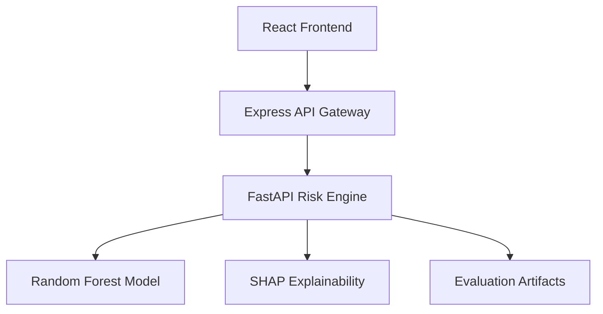

# ARGUS — Intelligent Transaction Fraud Detection

ARGUS is an ML-powered transaction fraud detection system that predicts transaction risk, classifies transactions into risk bands, and explains predictions using SHAP.

The project combines a React frontend, a TypeScript Express API gateway, and a Python FastAPI machine learning service.

## 1. Architecture



### Components

| Component           | Responsibility                                     |
| ------------------- | -------------------------------------------------- |
| React frontend      | Transaction input and result visualization         |
| Express gateway     | Validation, routing, rate limiting, error handling |
| FastAPI risk engine | Model inference and explanations                   |
| Random Forest       | Fraud probability prediction                       |
| SHAP                | Feature contribution explanations                  |

## 2. Technology Stack

- Frontend: React, TypeScript, Vite
- Backend gateway: Node.js, Express, TypeScript
- Risk engine: Python, FastAPI
- Machine learning: Scikit-learn
- Explainability: SHAP
- Validation: Zod and Pydantic
- Testing: Vitest, Supertest, Pytest

## 3. Repository Structure

```text
argus/
├── app/
│   ├── server/
│   │   └── src/
│   │       ├── clients/
│   │       ├── errors/
│   │       ├── middleware/
│   │       ├── routes/
│   │       ├── tests/
│   │       └── validators/
│   └── web/
│       └── src/
│           ├── charts/
│           ├── components/
│           ├── hooks/
│           ├── pages/
│           ├── services/
│           └── types/
├── artifacts/
├── data/
│   └── raw/
├── docs/
│   ├── decisions/
│   ├── eval-results/
│   ├── api-contracts.md
│   ├── architecture.md
│   ├── deployments.md
│   ├── product-brief.md
│   └── requirements.md
├── services/
│   └── risk-engine/
│       ├── scripts/
│       ├── src/
│       │   └── argus/
│       ├── tests/
│       ├── pyproject.toml
│       └── requirements.lock.txt
└── tests/
    ├── abuse/
    ├── e2e/
    ├── integration/
    └── security/
```

## 4. API Endpoints

### Express Gateway

Base URL: `http://localhost:3000`

| Method | Endpoint               | Description                 |
| ------ | ---------------------- | --------------------------- |
| POST   | `/api/score`           | Score a transaction         |
| GET    | `/api/metrics`         | Retrieve model metrics      |
| GET    | `/api/threshold-curve` | Retrieve threshold analysis |

### FastAPI Risk Engine

Base URL: `http://127.0.0.1:8000`

| Method | Endpoint           | Description                 |
| ------ | ------------------ | --------------------------- |
| GET    | `/health`          | Check service health        |
| POST   | `/score`           | Generate a fraud prediction |
| GET    | `/metrics`         | Retrieve model metrics      |
| GET    | `/threshold-curve` | Retrieve threshold analysis |

## 5. Transaction Input

The scoring API expects exactly 30 numeric features:

- `Time`
- `Amount`
- `V1` through `V28`

Example request:

```json
{
  "Time": 1000,
  "Amount": 150.5,
  "V1": 0.1,
  "V2": -0.2,
  "V3": 0.3
}
```

This is only a partial illustration. A valid request must include all 30 features.

## 6. Prediction Response

A successful prediction includes:

- `probability`: Estimated fraud probability.
- `risk_band`: LOW, MEDIUM, or HIGH.
- `exceeds_threshold`: Whether the probability exceeds the selected threshold.
- `threshold`: Selected decision threshold.
- `top_contributions`: Important SHAP feature contributions.

## 7. Model Evaluation

ARGUS uses a chronological train-validation-test split.

The final Random Forest model was evaluated once on the sealed test set using a threshold selected from validation data.

| Metric    | Test Result |
| --------- | ----------: |
| PR-AUC    |      0.7686 |
| ROC-AUC   |      0.9720 |
| Recall    |      0.7885 |
| Precision |      0.3832 |

The test set was not used for model selection or threshold tuning.

Detailed results: `docs/eval-results/2026-11-04.md`

## 8. Local Development

### Prerequisites

- Node.js and npm
- Python 3.10 or newer
- Trained model artifacts

### Start the Risk Engine

```powershell
cd services/risk-engine

python -m venv .venv
.\.venv\Scripts\Activate.ps1

python -m pip install -r requirements.lock.txt
python -m pip install -e .

python -m uvicorn argus.serve:app --reload --port 8000
```

### Start the Express Gateway

Open another terminal:

```powershell
cd app/server

npm install
npm run dev
```

### Start the Frontend

Open another terminal:

```powershell
cd app/web

npm install
npm run dev
```

Refer to `docs/deployments.md` for configuration and deployment details.

## 9. Testing

### Express Gateway

```powershell
cd app/server

npm run typecheck
npm run test
npm run build
```

### Python Risk Engine

```powershell
cd services/risk-engine

python -m pytest
```

## 10. Current Implementation Status

| Component                     | Status                 |
| ----------------------------- | ---------------------- |
| Model training and evaluation | Completed              |
| Threshold selection           | Completed              |
| SHAP explainability           | Implemented            |
| FastAPI risk engine           | Implemented            |
| Express API gateway           | Implemented and tested |
| React frontend                | Pending                |
| Frontend integration          | Pending                |
| End-to-end testing            | Pending                |
| Production deployment         | Pending                |

## 11. Documentation

- `docs/product-brief.md` — Product scope and goals
- `docs/requirements.md` — Functional and non-functional requirements
- `docs/architecture.md` — System architecture and component responsibilities
- `docs/api-contracts.md` — API request and response contracts
- `docs/deployments.md` — Local setup and deployment guidance
- `docs/decisions/` — Architecture decision records
- `docs/eval-results/` — Model evaluation reports

## 12. Disclaimer

ARGUS is an educational and engineering project demonstrating machine learning, API design, and explainability. It is not a certified financial fraud prevention system and should not be used to make real financial decisions without further validation, security review, and operational controls.
