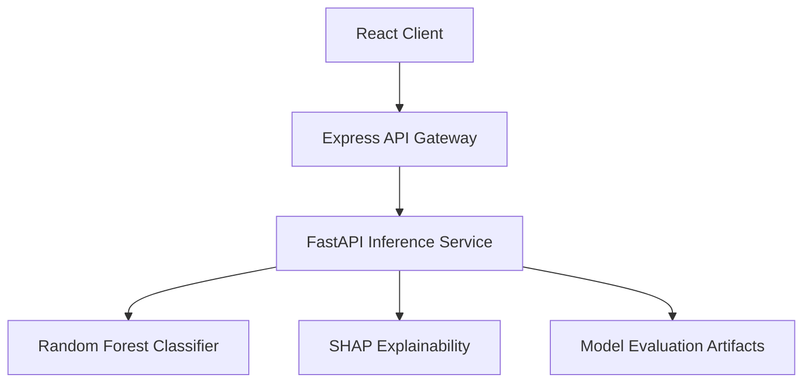

# ARGUS
### Intelligent Transaction Fraud Detection & Explainability Platform

ARGUS is a machine learning-based transaction risk assessment system designed to identify potentially fraudulent transactions, quantify prediction confidence, and explain model decisions through feature-level attribution.

The platform follows a modular service architecture, separating the presentation layer, API gateway, and machine learning inference service.

## System Architecture



### Service Responsibilities

| Service | Responsibility |
|---|---|
| Web Client | Transaction submission, prediction visualization, and model evaluation dashboards |
| API Gateway | Request validation, routing, rate limiting, and centralized error handling |
| Risk Engine | Feature processing, model inference, and prediction explanations |
| ML Model | Fraud probability estimation and risk classification |
| Explainability Layer | Global and transaction-level feature attribution |

## Technology Stack

| Layer | Technologies |
|---|---|
| Frontend | React.js, TypeScript, Vite |
| API Gateway | Node.js, Express, TypeScript |
| Inference Service | Python, FastAPI |
| Machine Learning | Scikit-learn, Random Forest |
| Explainability | SHAP |
| Validation | Zod, Pydantic |
| Testing | Vitest, Supertest, Pytest |
| Containerization | Docker |

## Repository Structure

```text
argus/
├── app/
│   ├── server/
│   │   └── src/
│   │       ├── clients/
│   │       ├── errors/
│   │       ├── middleware/
│   │       ├── routes/
│   │       ├── tests/
│   │       └── validators/
│   └── web/
│       └── src/
│           ├── charts/
│           ├── components/
│           ├── hooks/
│           ├── pages/
│           ├── services/
│           └── types/
├── artifacts/
├── data/
│   └── raw/
├── docs/
│   ├── decisions/
│   ├── eval-results/
│   ├── api-contracts.md
│   ├── architecture.md
│   ├── deployments.md
│   ├── product-brief.md
│   └── requirements.md
├── services/
│   └── risk-engine/
│       ├── scripts/
│       ├── src/argus/
│       ├── tests/
│       ├── pyproject.toml
│       └── requirements.lock.txt
├── tests/
│   ├── abuse/
│   ├── e2e/
│   ├── integration/
│   └── security/
├── Dockerfile
├── start.sh
└── .dockerignore
```

## Machine Learning Pipeline

ARGUS uses a Random Forest classifier trained on transaction-level features.

**Input schema**

The scoring interface expects 30 numeric features:

- `Time`
- `Amount`
- `V1` through `V28`

**Prediction outputs**

| Field | Description |
|---|---|
| `probability` | Estimated fraud probability |
| `risk_band` | LOW, MEDIUM, or HIGH |
| `exceeds_threshold` | Indicates whether the selected decision threshold is exceeded |
| `threshold` | Active classification threshold |
| `top_contributions` | Feature-level SHAP contributions |

The model produces a probability estimate, while the decision threshold determines whether that estimate exceeds the configured fraud classification boundary.

## API Reference

### Express API Gateway

| Method | Endpoint | Description |
|---|---|---|
| POST | `/api/score` | Transaction risk prediction |
| GET | `/api/metrics` | Model evaluation metrics |
| GET | `/api/threshold-curve` | Threshold performance analysis |
| GET | `/api/shap-global` | Global feature attribution |

### FastAPI Risk Engine

| Method | Endpoint | Description |
|---|---|---|
| GET | `/health` | Service health check |
| POST | `/score` | Model inference |
| GET | `/metrics` | Evaluation metrics |
| GET | `/threshold-curve` | Threshold analysis |
| GET | `/shap-global` | Global SHAP explanations |

The Express gateway provides the client-facing API boundary, while the FastAPI service encapsulates model inference and explainability operations.

## Model Evaluation

The evaluation pipeline uses a chronological train-validation-test split to preserve temporal ordering and reduce information leakage.

The final Random Forest model was evaluated on a held-out test set. The classification threshold was selected using validation data rather than the test set.

| Metric | Test Result |
|---|---:|
| PR-AUC | 0.7686 |
| ROC-AUC | 0.9720 |
| Recall | 0.7885 |
| Precision | 0.3832 |

These metrics describe performance on the evaluated dataset and should not be interpreted as guarantees of real-world fraud detection performance.

Detailed evaluation: [`docs/eval-results/2026-11-04.md`](docs/eval-results/2026-11-04.md)

## Local Development

### Prerequisites

- Node.js and npm
- Python 3.10 or newer
- Trained model artifacts

### 1. Risk Engine

```powershell
cd services/risk-engine

python -m venv .venv
.\.venv\Scripts\Activate.ps1

python -m pip install -r requirements.lock.txt
python -m pip install -e .

python -m uvicorn argus.serve:app --reload --port 8000
```

### 2. API Gateway

In a separate terminal:

```powershell
cd app/server

npm install
npm run dev
```

### 3. Web Client

In another terminal:

```powershell
cd app/web

npm install
npm run dev
```

For environment configuration and deployment procedures, refer to [`docs/deployments.md`](docs/deployments.md).

## Verification & Testing

**API Gateway**

```powershell
cd app/server

npm run typecheck
npm test
npm run build
```

**Risk Engine**

```powershell
cd services/risk-engine

python -m pytest
```

**Web Client**

```powershell
cd app/web

npm run lint
npm run build
```

## Implementation Status

| Area | Status |
|---|---|
| Model training and evaluation | Completed |
| Threshold selection | Completed |
| SHAP explainability | Implemented |
| FastAPI inference service | Implemented |
| Express API gateway | Implemented and tested |
| React web client | Implemented |
| Frontend-backend integration | Completed |
| Containerized deployment | Implemented |
| End-to-end verification | Deployment integration verified |

## Engineering Documentation

| Document | Purpose |
|---|---|
| `docs/product-brief.md` | Product scope and objectives |
| `docs/requirements.md` | Functional and non-functional requirements |
| `docs/architecture.md` | Architecture and service boundaries |
| `docs/api-contracts.md` | API request and response specifications |
| `docs/deployments.md` | Environment configuration and deployment procedures |
| `docs/decisions/` | Architecture decision records |
| `docs/eval-results/` | Model evaluation reports |

## Limitations & Disclaimer

ARGUS is an educational engineering project demonstrating machine learning, explainable AI, API architecture, and deployment practices.

Its predictions are model-generated risk estimates, not definitive fraud determinations. The system has not been certified or validated for production financial decision-making. Real-world adoption would require additional validation, security assessment, monitoring, reliability controls, and regulatory review.
