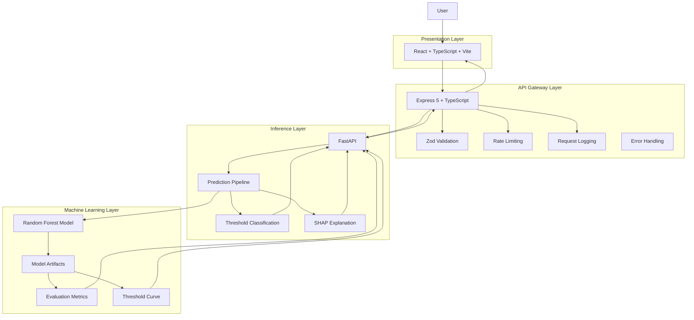
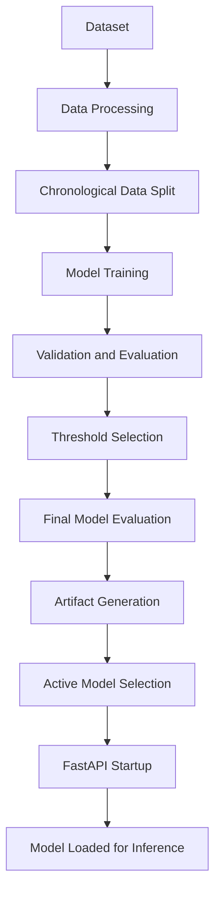
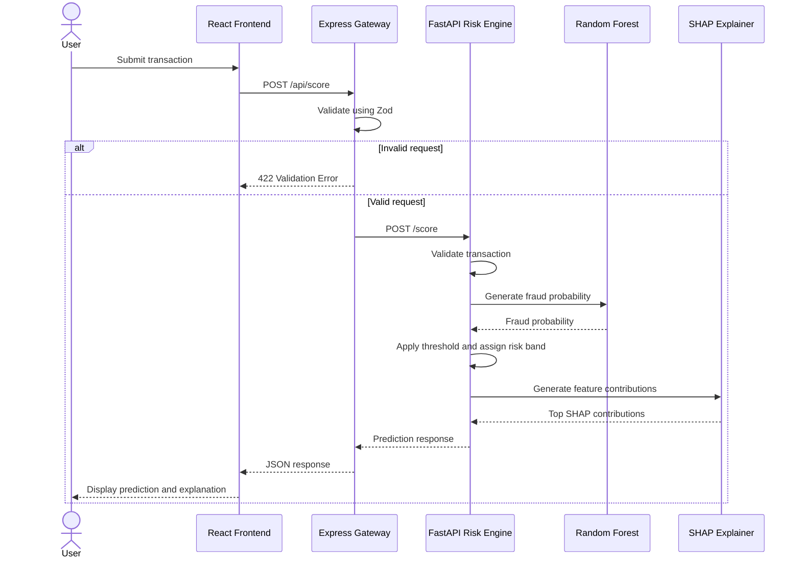

# ARGUS — System Architecture

## 1. System Overview

ARGUS is an AI-powered financial fraud detection system that evaluates transaction data, estimates fraud probability, classifies transaction risk, and provides model-driven explanations for individual predictions.

The system follows a layered service architecture with clearly separated responsibilities:

- **Presentation Layer:** React frontend for transaction submission and analytical visualization.
- **API Gateway Layer:** Express and TypeScript for request validation, API orchestration, and error handling.
- **Inference Layer:** FastAPI for model inference, threshold-based classification, and SHAP explanations.
- **Machine Learning Layer:** Scikit-learn model and associated evaluation and explanation artifacts.

The architecture separates frontend concerns, API orchestration, and machine learning inference. This allows each component to evolve independently while maintaining a stable API contract.

## 2. Architectural Principles

ARGUS follows these design principles:

### 2.1 Separation of Concerns

Each service has a defined responsibility. The frontend handles presentation, Express handles API-facing concerns, and FastAPI handles machine learning inference.

### 2.2 Explicit Service Boundaries

The React application communicates with the Express Gateway. The gateway communicates with the FastAPI Risk Engine.

The frontend does not directly access model artifacts or invoke the machine learning model.

### 2.3 Contract-Driven Integration

The services communicate through documented JSON REST APIs.

The API contracts define request features, response structures, validation rules, and error responses.

### 2.4 Reproducible Model Serving

The inference service loads a selected model and its associated artifacts during application startup.

Model evaluation and threshold selection are performed separately from transaction inference.

### 2.5 Explainability

Predictions include SHAP-based feature contributions to provide insight into the factors influencing individual fraud predictions.

## 3. High-Level Architecture



## 4. Component Responsibilities

### 4.1 Presentation Layer — React Frontend

**Technology:** React, TypeScript, Vite

**Location:** `app/web`

Responsibilities:

- Collect transaction input.
- Submit transaction data to the backend.
- Display fraud probability and risk classification.
- Visualize individual SHAP feature contributions.
- Display model evaluation metrics.
- Visualize threshold performance.

The frontend consumes the Express Gateway API rather than communicating directly with the inference service.

**Implementation status:** Pending.

### 4.2 API Gateway Layer — Express

**Technology:** Node.js, Express 5, TypeScript, Zod

**Location:** `app/server`

The gateway acts as the boundary between the frontend and the machine learning service.

Responsibilities:

**Request validation**

- Validate the 30 transaction features using Zod.
- Reject missing, non-numeric, non-finite, negative Time or Amount, and unexpected fields.
- Prevent invalid requests from reaching the inference service.

**Service communication**

- Forward valid requests to FastAPI.
- Apply request timeouts.
- Handle upstream connection failures.
- Reject unsuccessful or malformed upstream responses.

**Operational middleware**

- Apply rate limiting to `/api` routes.
- Log request method, path, status code, and duration.
- Avoid logging transaction request bodies.

**Error handling**

- Convert service errors into structured JSON responses.
- Prevent internal implementation details from leaking through unexpected errors.

Gateway endpoints:

| Method | Endpoint               | Responsibility                      |
| ------ | ---------------------- | ----------------------------------- |
| POST   | `/api/score`           | Transaction scoring                 |
| GET    | `/api/metrics`         | Retrieve evaluation metrics         |
| GET    | `/api/threshold-curve` | Retrieve threshold performance data |

The gateway does not independently calculate fraud predictions or modify the machine learning decision threshold.

### 4.3 Inference Layer — FastAPI

**Technology:** Python, FastAPI, Scikit-learn, SHAP

**Location:** `services/risk-engine`

The inference service owns the machine learning execution lifecycle.

Responsibilities:

- Load the active model and associated artifacts.
- Validate transaction input.
- Generate fraud probability predictions.
- Apply the configured classification threshold.
- Assign a risk band.
- Generate SHAP feature contributions.
- Serve evaluation metrics and threshold curve data.
- Expose a health endpoint.

Inference endpoints:

| Method | Endpoint           | Responsibility                     |
| ------ | ------------------ | ---------------------------------- |
| GET    | `/health`          | Service and model health           |
| POST   | `/score`           | Generate a transaction prediction  |
| GET    | `/metrics`         | Retrieve model evaluation results  |
| GET    | `/threshold-curve` | Retrieve threshold evaluation data |

The inference service is independent of frontend presentation and gateway-specific request handling.

### 4.4 Machine Learning Layer

**Technology:** Scikit-learn, Pandas, SHAP, Joblib

The current inference model is a trained Random Forest classifier.

The machine learning pipeline is responsible for:

1. Receiving validated transaction features.
2. Generating fraud probability.
3. Applying the configured threshold.
4. Producing a risk classification.
5. Generating feature-level SHAP explanations.

Model training, validation, threshold selection, and final evaluation are separate from the online inference path.

## 5. Model Artifact Management

ARGUS separates trained model artifacts from application source code.

The active model is selected through:

`artifacts/current.json`

The active model directory contains the following artifacts:

| Artifact               | Responsibility                         |
| ---------------------- | -------------------------------------- |
| `model.joblib`         | Serialized trained Random Forest model |
| `evaluation.json`      | Model evaluation results               |
| `threshold_curve.json` | Threshold performance data             |
| `metadata.json`        | Model metadata                         |
| `shap_global.json`     | Global SHAP explanation information    |

The FastAPI application loads the model, threshold, evaluation metrics, threshold curve, and SHAP explainer during startup.

This approach keeps inference requests independent of model training.

### Artifact Lifecycle



The model training and evaluation workflow is an offline process. Transaction scoring uses the already generated artifacts.

## 6. Transaction Prediction Data Flow

The following describes the runtime request lifecycle.



### Prediction Response

The scoring endpoint returns:

| Field               | Description                                              |
| ------------------- | -------------------------------------------------------- |
| `probability`       | Estimated fraud probability                              |
| `risk_band`         | LOW, MEDIUM, or HIGH                                     |
| `exceeds_threshold` | Whether the probability exceeds the configured threshold |
| `threshold`         | Active classification threshold                          |
| `top_contributions` | Up to five SHAP feature contributions                    |

Each SHAP contribution contains:

- `feature`
- `feature_value`
- `shap_value`
- `direction`

SHAP contributions explain the model prediction. They should not be interpreted as proof of causation.

## 7. Model Evaluation Data Flow

Evaluation metrics and threshold curves are generated during the offline model evaluation process.

At runtime:

1. The frontend requests evaluation data through Express.
2. Express forwards the request to FastAPI.
3. FastAPI retrieves the loaded evaluation artifacts.
4. Express forwards the returned data.
5. The frontend visualizes the results.

The gateway does not recalculate model evaluation metrics.

## 8. Reliability and Error Handling

### Gateway Reliability

The Express Gateway implements:

- Request validation.
- Upstream request timeout.
- Connection failure handling.
- Upstream HTTP error handling.
- Invalid JSON response handling.
- Structured error responses.
- API rate limiting.
- Request logging.

### Error Mapping

| HTTP Status | Error Code              | Meaning                                            |
| ----------- | ----------------------- | -------------------------------------------------- |
| 422         | `VALIDATION_ERROR`      | Invalid client request                             |
| 429         | `RATE_LIMIT_EXCEEDED`   | Rate limit exceeded                                |
| 502         | `UPSTREAM_ERROR`        | Upstream service returned an unsuccessful response |
| 502         | `INVALID_RESPONSE`      | Invalid upstream response                          |
| 503         | `CONNECTION_FAILED`     | Risk Engine unavailable                            |
| 504         | `TIMEOUT`               | Upstream request timed out                         |
| 500         | `INTERNAL_SERVER_ERROR` | Unexpected gateway failure                         |

### Current Operational Limitations

- The rate limiter uses in-memory storage.
- Multiple gateway instances would require a shared rate-limit store.
- Service availability depends on the FastAPI inference service being reachable.
- Production deployment configuration and monitoring remain future work.

## 9. Repository Structure

```text
ARGUS/
├── app/
│   ├── server/
│   │   └── src/
│   │       ├── clients/
│   │       ├── errors/
│   │       ├── middleware/
│   │       ├── routes/
│   │       ├── tests/
│   │       └── validators/
│   └── web/
│       └── src/
│           ├── charts/
│           ├── components/
│           ├── hooks/
│           ├── pages/
│           ├── services/
│           └── types/
├── artifacts/
├── data/
├── docs/
│   ├── decisions/
│   └── eval-results/
├── services/
│   └── risk-engine/
│       ├── scripts/
│       ├── src/
│       └── tests/
└── tests/
    ├── abuse/
    ├── e2e/
    ├── integration/
    └── security/
```

## 10. Implementation Status

| Component                         | Status                |
| --------------------------------- | --------------------- |
| Dataset processing                | Implemented           |
| Chronological data splitting      | Implemented           |
| Model training and evaluation     | Implemented           |
| Threshold selection               | Implemented           |
| SHAP explainability               | Implemented           |
| FastAPI inference service         | Implemented           |
| Express API Gateway               | Implemented           |
| Gateway validation and middleware | Implemented           |
| Gateway automated tests           | Initial tests passing |
| React frontend                    | Pending               |
| Frontend integration              | Pending               |
| End-to-end testing                | Pending               |
| Production deployment             | Pending               |

## 11. Future Architectural Considerations

The following are potential improvements, not existing capabilities:

- Shared rate-limit storage for horizontally scaled gateway instances.
- Authentication and authorization for protected operations.
- Centralized structured logging and monitoring.
- Model versioning and controlled model promotion.
- Automated deployment pipelines.
- Integration and end-to-end testing across all services.
- Frontend error boundaries and resilient API state management.

These improvements should be introduced based on actual deployment and product requirements rather than adding infrastructure prematurely.
