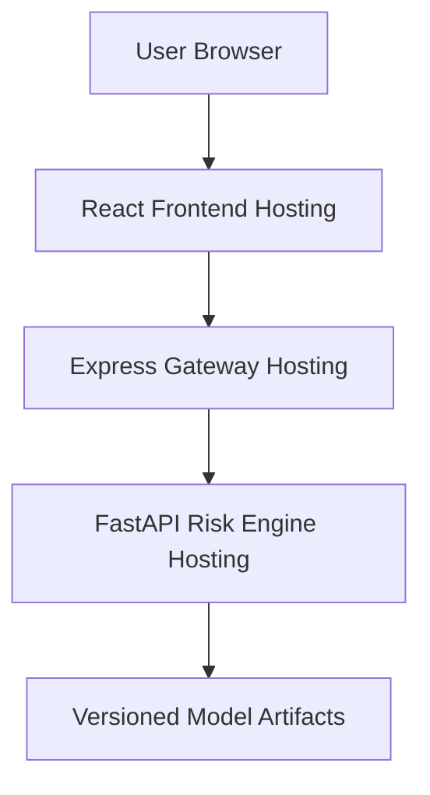

# ARGUS — Deployment and Operations Guide

## 1. Overview

ARGUS consists of three application components:

1. React frontend — user interface.
2. Express API Gateway — frontend-facing backend.
3. FastAPI Risk Engine — machine learning inference service.

The Express Gateway communicates with the FastAPI service through HTTP REST APIs.

This document covers local development, environment configuration, verification, and the planned production deployment architecture.

## 2. Prerequisites

Required software:

| Software | Purpose                            |
| -------- | ---------------------------------- |
| Node.js  | Express Gateway and React frontend |
| npm      | JavaScript dependency management   |
| Python   | Machine learning inference service |
| pip      | Python dependency management       |
| Git      | Version control                    |

Ensure the required software is installed and available in the terminal.

## 3. Environment Configuration

### 3.1 Express API Gateway

Location: `app/server/.env`

```env
PORT=3000
RISK_ENGINE_URL=http://127.0.0.1:8000
RISK_ENGINE_TIMEOUT_MS=5000
```

| Variable                 | Default                 | Description                                       |
| ------------------------ | ----------------------- | ------------------------------------------------- |
| `PORT`                   | `3000`                  | Express server port                               |
| `RISK_ENGINE_URL`        | `http://127.0.0.1:8000` | FastAPI service URL                               |
| `RISK_ENGINE_TIMEOUT_MS` | `5000`                  | Maximum upstream request duration in milliseconds |

The `.env` file must remain private and must not be committed to version control.

### 3.2 FastAPI Risk Engine

The FastAPI service uses the active model manifest and associated artifacts.

Ensure the artifact directory contains the active model and its required serving dependencies.

The active model is selected through:

`artifacts/current.json`

Required model artifacts:

- `model.joblib`
- `evaluation.json`
- `threshold_curve.json`

Additional explanation and metadata artifacts may also be required by the configured serving implementation.

## 4. Local Development Setup

Run the services in separate terminal windows.

### 4.1 Start the FastAPI Risk Engine

Open PowerShell:

```powershell
cd services/risk-engine

python -m venv .venv

.\.venv\Scripts\Activate.ps1

pip install -r requirements.lock.txt

python -m uvicorn argus.serve:app --reload --port 8000
```

Expected service URL:

`http://127.0.0.1:8000`

Verify the health endpoint:

```powershell
Invoke-RestMethod http://127.0.0.1:8000/health
```

Expected response:

```json
{
  "status": "ok",
  "model_loaded": true,
  "threshold": 0.1128755386620629
}
```

### 4.2 Start the Express API Gateway

Open another PowerShell terminal:

```powershell
cd app/server

npm install

npm run dev
```

Expected service URL:

`http://localhost:3000`

Verify the evaluation endpoint:

```powershell
Invoke-RestMethod http://localhost:3000/api/metrics
```

Verify the threshold curve endpoint:

```powershell
Invoke-RestMethod http://localhost:3000/api/threshold-curve
```

The scoring endpoint can be verified using a valid transaction containing all 30 required features.

## 5. Backend Build and Test Verification

Run these commands from `app/server`:

### TypeScript type checking

```powershell
npm run typecheck
```

### Production build

```powershell
npm run build
```

### Automated tests

```powershell
npm test
```

All checks should pass before considering the gateway ready for deployment.

## 6. Frontend Development

Location: `app/web`

The frontend will communicate with the Express Gateway.

Expected development URLs:

| Component           | URL                     |
| ------------------- | ----------------------- |
| React frontend      | `http://localhost:5173` |
| Express Gateway     | `http://localhost:3000` |
| FastAPI Risk Engine | `http://127.0.0.1:8000` |

Frontend development and API integration are pending.

Before browser-based integration, configure the frontend-to-gateway communication through an appropriate CORS policy or Vite development proxy.

## 7. Production Deployment Architecture

The intended production architecture is:



### Deployment responsibilities

**React Frontend**

- Build the React application.
- Host the static frontend.
- Configure the production API base URL.

**Express Gateway**

- Deploy the Node.js application.
- Configure production environment variables.
- Set the FastAPI service URL.
- Configure CORS for the trusted frontend origin.
- Configure rate limiting appropriately.

**FastAPI Risk Engine**

- Deploy the Python inference service.
- Install locked Python dependencies.
- Make the active model artifacts available.
- Verify model loading during startup.
- Expose health monitoring.

Production hosting providers and deployment configurations have not yet been finalized.

## 8. Production Configuration Requirements

Before production deployment:

- Keep secrets and environment variables outside source control.
- Configure HTTPS for externally accessible services.
- Restrict CORS to approved frontend origins.
- Ensure model artifacts are available to the inference service.
- Configure health checks for deployed services.
- Configure centralized logs and error monitoring.
- Review rate limits and shared storage requirements.
- Verify service-to-service connectivity.
- Test invalid requests and upstream failures.

The current Express rate limiter uses in-memory storage. A shared store should be considered if multiple gateway instances are deployed.

## 9. Deployment Verification Checklist

### Local backend

- [ ] FastAPI starts successfully.
- [ ] FastAPI health endpoint returns a healthy response.
- [ ] Express Gateway starts successfully.
- [ ] Express metrics endpoint works.
- [ ] Express threshold curve endpoint works.
- [ ] Express scoring endpoint works.
- [ ] Invalid requests return structured validation errors.
- [ ] TypeScript type checking passes.
- [ ] Production build passes.
- [ ] Automated tests pass.

### Frontend integration

- [ ] React application starts successfully.
- [ ] React communicates with Express.
- [ ] Transaction scoring works through the UI.
- [ ] Prediction results display correctly.
- [ ] SHAP explanations display correctly.
- [ ] Metrics and threshold visualizations work.

### Production deployment

- [ ] Frontend deployed.
- [ ] Express Gateway deployed.
- [ ] FastAPI Risk Engine deployed.
- [ ] Production environment variables configured.
- [ ] Model artifacts loaded successfully.
- [ ] HTTPS and CORS verified.
- [ ] End-to-end tests pass.
- [ ] Health monitoring verified.

## 10. Current Deployment Status

| Component                          | Status                |
| ---------------------------------- | --------------------- |
| FastAPI local execution            | Implemented           |
| Express local execution            | Implemented           |
| Local service integration          | Verified              |
| Gateway automated tests            | Initial tests passing |
| Frontend deployment                | Pending               |
| Backend production deployment      | Pending               |
| End-to-end production verification | Pending               |
